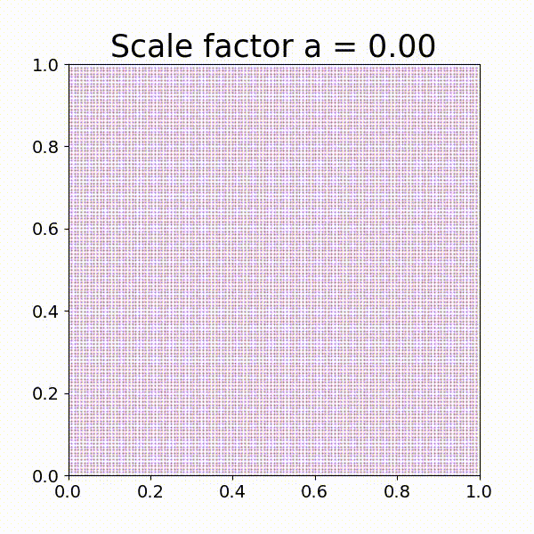

## Hi, I'm Lena! 

<!--
**lnnrmhf/lnnrmhf** is a ✨ _special_ ✨ repository because its `README.md` (this file) appears on your GitHub profile.

Here are some ideas to get you started:

- 🔭 I’m currently working on ...
- 🌱 I’m currently learning ...
- 👯 I’m looking to collaborate on ...
- 🤔 I’m looking for help with ...
- 💬 Ask me about ...
- 📫 How to reach me: ...
- 😄 Pronouns: ...
- ⚡ Fun fact: ...

# 📊 GitHub Stats:
 
 

---

## 🗒️ GitHub Stats:

<!-- Proudly created with GPRM ( https://gprm.itsvg.in ) -->

<!-- Proudly created with GPRM ( https://gprm.itsvg.in ) -->
I am a Masters student of Astronomy at the University of Vienna with a strong interest in computational cosmology and data analysis. I am particularly enthusiastic about
combining large-scale data analysis with physical insight into the large-scale structure of the Universe and its evolution.
<!--
  

  -->

## About Me: 
- 🪐 Masters student in Astronomy (University of Vienna)  
- 🌌 Interested in cosmology, reionization and large-scale structure  
- 💻 Focused on large-scale data analysis and simulation-based research  
- ✨ Currently involved in research within the Data Science in Astrophysics and Cosmology group at the University of Vienna  
- 🌸 Pronouns: she/her 

  

## Languages:
Primary focus on Python-based data analysis, with additional experience in C++, Java and R.
<!-- 
   
-->

   

  

  <em>Formation of the cosmic web through linear displacement from an initially uniform density field.</em>
  <a href="media/cosmic_web.mp4">Full-resolution video</a>

<!-- Proudly created with GPRM ( https://gprm.itsvg.in ) -->
  

<!-- Proudly created with GPRM ( https://gprm.itsvg.in ) -->
